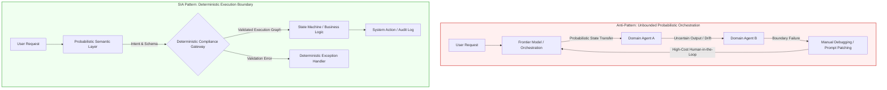

# Enterprise Anti-Pattern: The $200/hr Prompt Engineering Debt

## Executive Summary

Six months post-deployment, enterprise Generative AI initiatives frequently encounter a structural wall: high-value domain experts spending substantial billable hours manually engineering system prompts and debugging multi-agent handoffs. 

This document outlines the failure modes of offloading system orchestration onto probabilistic models, analyzes the resulting operational debt, and details how the Sovereign Infrastructure Architecture (SIA) establishes deterministic boundaries to ensure enterprise resilience.

---

## Architectural Problem Statement

Current enterprise agent deployments suffer from **Probabilistic Handoff Debt**. When multi-agent systems rely on probabilistic foundation models to handle structural state transitions, semantic drift inevitably introduces non-deterministic execution paths.

## Key Structural Failure Modes
Rebranded Orchestration Debt: Pushing systemic boundary resolution into prompt context turns operational risk into perpetual API consumption and expert toil.
Semantic Drift in High-Stakes Workflows: Probabilistic models cannot guarantee strict compliance boundaries without hard-coded schema validation and deterministic enforcement layers.
Misaligned Expert Allocation: Domain specialists act as real-time state debuggers rather than strategic decision-makers.

# The Separation of Concerns in SIA
To eliminate $200/hr prompt engineering debt, SIA enforces a strict boundary between probabilistic intelligence and deterministic authority:

| Architectural Axis | Probabilistic Layer | Deterministic Governance Layer (SIA) |
| :--- | :--- | :--- |
| **Primary Function** | Semantic comprehension, unstructured extraction, natural language interface | State transition validation, schema enforcement, compliance verification |
| **Execution Authority** | Read-only analysis & intent proposals | Final transactional commit & system API invocation |
| **Error Handling** | Model regeneration / Context re-prompting | Circuit breakers, deterministic fallbacks, structured audit logging |
| **Governance Metric** | Semantic similarity & relevance score | Absolute pass/fail compliance policy |

# SIA Implementation Strategy
Restricting Frontier Models: Limit LLMs exclusively to unstructured semantic mapping, query understanding, and candidate extraction.
Hard-Bound State Machines: Route all multi-step agent actions through external, strongly typed state machine architectures.
Deterministic Governance Gateways: Enforce pre-execution and post-execution validation barriers that block non-compliant outputs before reaching downstream enterprise infrastructure.
* This document was structured with the help of AI, and curated by **Sana.M***
